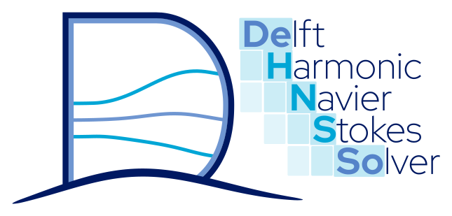

New<b>DeHNSSo-v2</b>, a compressible, curvilinear, and efficient harmonic Navier&ndash;Stokes solver for boundary-layer stability, is now on arXiv. <a href="https://doi.org/10.48550/arXiv.2610.27906">Read the preprint</a>

I'm a postdoctoral researcher at the Delft University of Technology with particular interest in **flow instabilities**, **laminar-to-turbulent transition**, and **flow control**. My major focus lies on **highly compressible and non-ideal fluid flows**, in which unconventional high-temperature and gas dynamic effects are extremely relevant. My work combines **high-fidelity simulations**, **high-performance computing**, and **stability-analysis tools**.

My PhD research in the group of [Rene Pecnik](https://dutw1479.wbmt.tudelft.nl/~renep/) focused on the stability and transition to turbulence of **fluids at supercritical pressure**, which feature strong variations of properties (viscosity, density, etc.).

My postdoctoral research in the group of [Marios Kotsonis](https://www.tudelft.nl/staff/m.kotsonis/) focuses on **flow control through metamaterials**, with the aim of postponing transition, thereby reducing turbulence and mitigating its impact on aerodynamic drag and noise.

<h2 class="home-h" style="clear: both;"><i class="fa-solid fa-bullhorn"></i><a href="/blog/" style="color: inherit">News</a></h2>


<h2 class="home-h"><i class="fa-solid fa-wind"></i>Research highlight</h2>

  <video autoplay loop muted playsinline preload="auto" poster="/assets/video/breakdown_poster.jpg">
    <source src="/assets/video/breakdown.mp4" type="video/mp4">
  </video>
  
<b>Breakdown to turbulence at supercritical pressure.</b> Direct numerical simulation of a heated boundary layer crossing the Widom line: vortical structures (Q-criterion, coloured by streamwise velocity) and regions of flow reversal (cyan) over one forcing period. <a href="https://doi.org/10.1017/jfm.2025.10993">J. Fluid Mech. 2025</a> &middot; <a href="https://github.com/pcboldini/DNSvisualisation">all movies</a>

<h2 class="home-h"><i class="fa-solid fa-route"></i>Career</h2>

  

2025&ndash;nowPostdoctoral researcher, Aerodynamics Group, TU Delft (ERC MetaWing)

  

2020&ndash;2025PhD, Process &amp; Energy Department, TU Delft (ERC Critical)

  

2019&ndash;2020Research associate, Institute of Aerodynamics and Gas Dynamics, University of Stuttgart

  

2018MSc thesis, Laboratory for Advanced Simulation of Turbulence, Tsinghua University, Beijing

  

2012&ndash;2018BSc and MSc in Aerospace Engineering, University of Stuttgart

<h2 class="home-h"><i class="fa-solid fa-code"></i>Open-source software</h2>

  

    
    

      <b>CUBENS</b>: GPU-accelerated, high-order DNS solver for wall-bounded flows with non-ideal fluids. 
      
       
      <a class="btn btn-sm z-depth-0" role="button" href="https://github.com/pcboldini/CUBENS">GitHub</a>
      <a class="btn btn-sm z-depth-0" role="button" href="https://doi.org/10.1016/j.cpc.2025.109507">Paper</a>
      

Cite
<pre>@article{Boldini2025CUBENS,
  title   = {CUBENS: A GPU-accelerated high-order solver for wall-bounded flows with non-ideal fluids},
  author  = {Boldini, P. C. and Hirai, R. and Costa, P. and Peeters, J. W. R. and Pecnik, R.},
  journal = {Computer Physics Communications},
  volume  = {309},
  pages   = {109507},
  year    = {2025},
  doi     = {10.1016/j.cpc.2025.109507}
}</pre>

    

  

  

    
    

      <b>DeHNSSo-v2</b>: harmonic Navier–Stokes solver for the linear and nonlinear stability of compressible boundary layers. 
      
       
      <a class="btn btn-sm z-depth-0" role="button" href="https://github.com/pcboldini/DeHNSSo">GitHub</a>
      <a class="btn btn-sm z-depth-0" role="button" href="https://doi.org/10.48550/arXiv.2610.27906">Preprint</a>
      

Cite
<pre>@misc{Boldini2026DeHNSSo,
  title         = {DeHNSSo-v2: A compressible, curvilinear, and efficient extension of the Delft Harmonic Navier--Stokes Solver},
  author        = {Boldini, P. C. and Chen, Y. and Kotsonis, M.},
  year          = {2026},
  eprint        = {2610.27906},
  archivePrefix = {arXiv}
}</pre>

    

  

ContactInterested in an MSc thesis or PhD project on laminar-to-turbulent transition, flow control, or GPU-accelerated simulation? Feel free to <a href="mailto:pietro.c.boldini@gmail.com">reach out</a>, also for collaborations.

